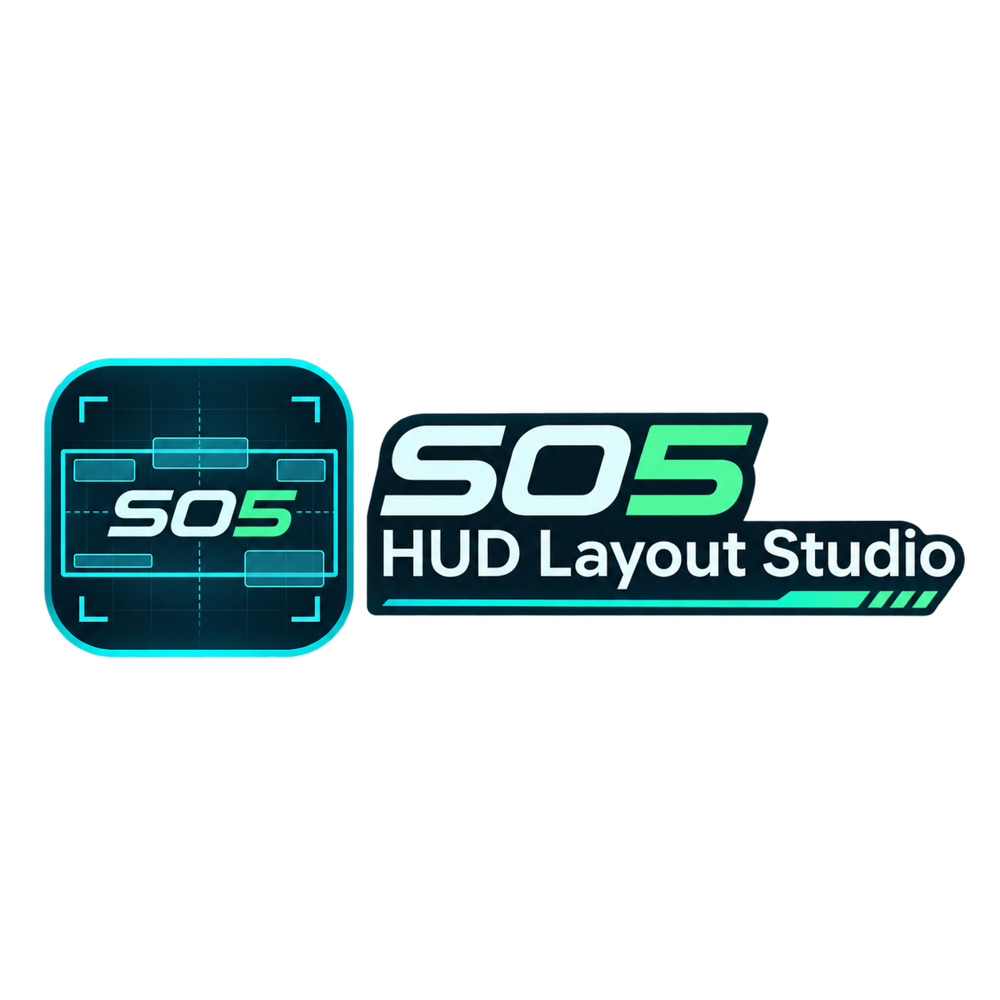
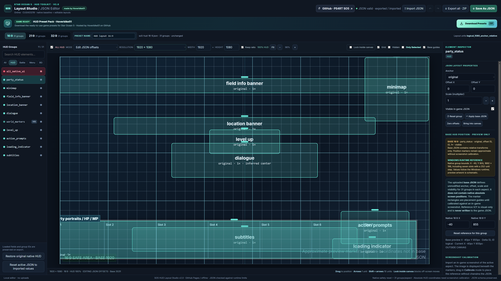

# Star Ocean 5 — HUD Layout Studio

**A standalone visual JSON preset editor for the Star Ocean 5: Integrity and Faithlessness Windows / PS4RT HUD research project.**

**Created by Hoverbike51** · **Current editor version: v1.8:** 
<a href="https://hoverbike51.github.io/SO5-HUD-Layout-Studio" rel="nofollow"></a></p>




<p align="center">
<a href="https://ps4rt.dev" rel="nofollow"></a></p>
<p align="center">  
<a href="https://github.com/Hoverbike51/Star-Ocean-Integrity-and-Faithlessness-PS4RT/releases" rel="nofollow"></a>
<a href="https://github.com/HekamiAeon/Star-Ocean-Integrity-and-Faithlessness-PS4RT/releases" rel="nofollow"></a>
</p>



## Overview

SO5 HUD Layout Studio lets you **inspect, adjust, calibrate, and export HUD layout JSON presets** without manually editing their structure. It supports three independent display profiles: **16:9**, **21:9**, and **32:9**.

The editor runs entirely in the browser. There is **no installer, server component, account requirement, build step, or external JavaScript dependency**. You may use it online through GitHub Pages or open `index.html` locally in a modern browser.

The application is a **research/development preview**, not the game's renderer. Its visual HUD bounds are calibration aids and must not be confused with guaranteed in-game coordinates.

## Features

| Feature | What it does |
| --- | --- |
| Three aspect-ratio profiles | Switch between separate 16:9, 21:9, and 32:9 HUD layouts. |
| Resolution presets | Select common screen sizes or enter custom canvas width and height. |
| Adaptive HUD preview | Scales the on-canvas layout with resolution; the game JSON keeps its logical coordinate system. |
| Visual positioning | Drag supported HUD groups or edit `offset_x` / `offset_y` directly. |
| Scale and anchor controls | Edit the supported group's `scale` and `anchor` settings. |
| Visibility controls | Show/hide individual HUD groups in the exported JSON. |
| Only Selected | Isolate the currently selected group **in the preview only**; does not rewrite JSON visibility. |
| Lock inside canvas | Prevent supported layout items from being moved outside the preview bounds. |
| Grid and guides | Toggle the grid, hidden-item display, and native-base visual guides. |
| Screenshot calibration | Import a PNG/JPEG/WebP screenshot to help align visual reference positions. |
| Separate calibration data | Save/import aspect-specific visual references independently of game layout JSON. |
| Native baseline comparison | Compare against bundled partial original/base HUD values and restore supported fields. |
| Preset name editor | Change a profile's JSON `name` and use it for the suggested exported filename. |
| Undo / Redo | Reverse and reapply preset changes. |
| JSON import | Load one or multiple compatible JSON layouts. |
| Save As JSON | Use a native file-save picker where the browser permits, with a download fallback. |
| Export all · ZIP | Export the three aspect-ratio layouts together. |

### Special visibility-only controls

The following groups intentionally **do not expose X/Y, anchor, or scale editing**:

- `all_native_ui` — the master global HUD visibility switch. It is highlighted red in the editor and includes the message **“This enable or disable all HUD group”**.
- `battle_target_selection` — target-selection UI.
- `enemy_awareness` — native draw/visibility binding remains unverified.
- `world_markers` — world-projected markers do not have one fixed screen rectangle.

The existing non-visibility JSON fields of these groups remain intact when editing their visibility.

### Visual references and placement

The editor includes several research-based preview references, including:

- A **seven-slot party-status strip** placed near the bottom of the 16:9 preview, based on the Studio 0.4.1 reference screenshot.
- A **centered battle radial menu** using the decoded `bm_topmenu/BM_BASE2` reference (448 × 448 within the 1920 × 1080 reference frame).
- A **760 × 180 dialogue-window reference** with an inferred centered screen position.

These are **preview/calibration references**, not independently verified native runtime placements for all displays. Use in-game screenshots and tests to refine them.

## Quick start

### Online

1. Open <a href="https://hoverbike51.github.io/SO5-HUD-Layout-Studio" rel="nofollow"></a></p>
2. Select **16:9**, **21:9**, or **32:9**.
3. Select a HUD group from the left sidebar.
4. Edit permitted fields in **Element Inspector**, or drag the group on the canvas.
5. Click **Save As JSON** for the active profile, or **Export all · ZIP** for all three.

### Import a preset

Click **Import JSON** and select one or more compatible layout files. A file replaces the in-memory profile associated with its `aspect` value; importing over a modified matching profile may trigger a confirmation.

The bundled starting profiles contain **31 HUD groups per aspect ratio**. The separate native-base reference datasets contain **15 groups per aspect ratio**; the missing 16 are **not deleted** from editable profiles.

## How to use the canvas

1. **Select** a HUD group in the left list, or click its marker on the canvas.
2. Choose the editing mode:
   - **Edit JSON offsets** — modifies the selected group's supported JSON layout fields.
   - **Calibrate reference positions** — moves the visual reference **without modifying JSON offsets**.
3. Choose a display resolution, or edit **WIDTH** and **HEIGHT**. Enable **Keep ratio** to retain the chosen aspect relationship.
4. Use **Fit** or the zoom controls if needed.
5. Enable **Grid**, **Base guides**, or **Only Selected** to make individual layout checks easier.
6. Enable **Lock inside canvas** if you do not want interactive edits to put markers off-screen.

The canvas uses the JSON's `logical_1080_anchor_relative` unit convention. Changing the preview resolution does **not** convert `offset_x` or `offset_y` into raw display pixels or add resolution fields to the game JSON.

### Keyboard and navigation

- **Arrow keys** — move a selected editable group by one logical unit.
- **Shift + arrow keys** — move it by ten logical units.
- **Ctrl + Z** — Undo.
- **Ctrl + Y** — Redo.

Some commands are not applicable to visibility-only groups. Check the on-screen status for the active editing mode.

## JSON compatibility and integrity

The current editor targets HUD-layout JSON objects with this general structure:

```json
{
  "schema_version": 1,
  "layout_map": "so5-cusa03219-01.00-hud-research",
  "title_id": "CUSA03219",
  "app_ver": "01.00",
  "name": "My SO5 HUD Preset",
  "aspect": "16:9",
  "units": "logical_1080_anchor_relative",
  "groups": [
    {
      "id": "party_status",
      "anchor": "original",
      "offset_x": 0,
      "offset_y": 0,
      "scale": 1,
      "visible": true
    }
  ]
}
```

> The example shows the expected **field structure**, not the complete 31-group preset. Use the app's bundled layouts or your compatible source JSON for actual editing.

The editor validates imported layouts and exported JSON, preserves group identity and count, and restricts edits to supported layout fields plus the preset `name`. Unmodified JSON can be exported without changing its existing structure and formatting.

**Always keep a backup** of working in-game presets. A syntactically valid JSON export does not establish that every game-side hook, HUD group, or placement works at runtime.

## Screenshot and calibration workflow

1. Select the corresponding aspect ratio and resolution.
2. Choose **Load screenshot** and import an in-game image.
3. Adjust its opacity to compare HUD groups and the background image.
4. Choose **Calibrate reference positions**.
5. Move the preview markers to match the screenshot.
6. Choose **Save calibration** to export those references separately.
7. Use **Import calibration** to restore them on another browser or PC.

Calibration reference positions are also stored in browser `localStorage` when available. They are **not** automatically written into the actual layout JSON. Clearing browser site data can delete locally stored calibration; export a calibration backup when the results matter.

## Save and export

- **Save As JSON**: validates and exports the active profile. Chrome/Edge may offer the native Windows **Save As** dialog; the suggested starting directory is **Downloads**, but the browser controls the actual location. When that API is unavailable, the normal download workflow is used.
- **Export all · ZIP**: bundles all three validated ratio-specific layouts.
- **Preset name**: changes the active layout's JSON `name` field; it can also influence the proposed file name.
- **Reset active JSON to imported values**: restores the selected aspect's imported values; use care before discarding edits.


## Privacy and requirements

- All editor processing takes place in your browser; the current application does not include a backend or a feature for uploading your imported JSON to a server.
- Imported game screenshots are processed locally for the on-page preview.
- GitHub Pages is a public hosting service, and GitHub may process ordinary site-visitor metadata under its own privacy terms.
- Recommended browser: a recent **Chrome** or **Edge** release. Native save dialogs depend on browser/API support and context.
- The actual game and PS4RT executable are **not** required to run the editor, but are needed for in-game validation.

## Publish with GitHub Pages

This repository is intended for the personal GitHub Pages site:

```text
Hoverbike51/hoverbike51.github.io/SO5-HUD-Layout-Studio
├── index.html                 # SO5 HUD Layout Studio v1.8
├── README.md                  # This documentation
├── LICENSE                    # Proposed MIT license for original editor code
├── .gitignore                 # Optional minimal ignore rules
└── assets/
    └──logo_hud_studio_HMV.png     # logo shown above
    └──studio-preview.png          # Screenshot shown above
```

## Known limitations

- The canvas is a **layout preview, not live game rendering**.
- Some native HUD elements are unmapped, visibility-only, or have unverified game-side bindings.
- Native-base JSONs provide the original relative layout fields for **15 groups**, not absolute pixel positions for all 31 groups.
- Visual bounding boxes are based on available research, decoded UI information, and screenshots; not all are confirmed in-game.
- Different game versions, executables, or hooks may behave differently from this research profile (`CUSA03219`, `01.00`).
- GitHub Pages alone does not provide user accounts or a shared server-side preset database; downloaded presets remain files unless an additional service is added.

## Related project and credits

**Studio development and attribution:** Hoverbike51 — [GitHub profile](https://github.com/Hoverbike51)

**Associated research/Windows port:** [Star Ocean 5 — PS4RT Windows project](https://github.com/Hoverbike51/Star-Ocean-Integrity-and-Faithlessness-PS4RT)

This tool is not affiliated with or endorsed by **Square Enix** or **tri-Ace**. *Star Ocean*, its characters, logos, game code, and original assets remain the property of their respective rights holders. Do not upload proprietary game assets to this repository unless you have permission to distribute them.

## License

**License: [MIT](LICENSE)**, for the original source code of this HUD editor. It permits use, modification, and redistribution while requiring retention of the copyright and license notices. The MIT license **does not transfer ownership or grant redistribution rights** over Star Ocean game assets, third-party trademarks, or other material you do not own.

**Copyright © 2026 Hoverbike51.**
